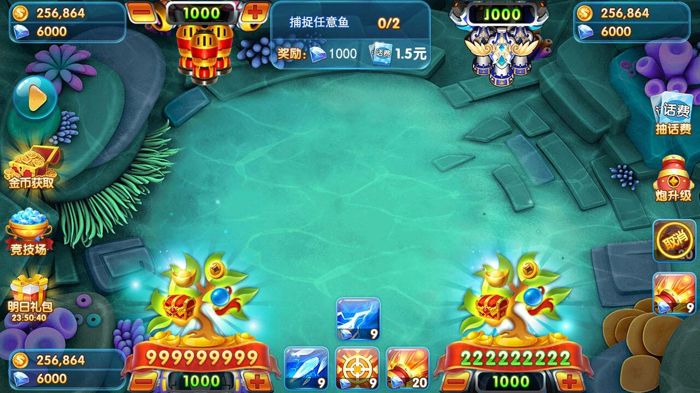

# 🎣 经典模式捕鱼游戏 - 高品质源码|捕鱼源码|捕鱼美术资源|捕鱼数值系统|捕鱼游戏核心数值文案 | 捕鱼文案|捕鱼数值|捕魚遊戲核心數值文案 | Fishing Game

> 产品品质高 | 美术精美 | 经典街机风格 | 可直接商用或二次开发|

## 📱 游戏截图

.jpg)# 万炮捕鱼源代码

## ✨ 核心特性
- 🐟 **经典捕鱼模式**：炮台升级、子弹碰撞、鱼群游动轨迹
- 🎨 **精美美术资源**：高质量鱼类/场景/特效，还原街机质感
- ⚡ **流畅性能**：支持大量鱼群与子弹碰撞不卡顿
- 🎵 **音效与动画**：击中反馈、炮台旋转、金币特效
- 🛠️ **技术栈**：Unity / Cocos Creator / Egret（根据实际填写）

## 🔧 运行环境
- Unity 2021.3+ / Cocos Creator 3.x（根据实际）
- 支持平台： Android / iOS

## 📥 获取完整源码
本仓库仅展示项目说明，**完整源码及美术资源**请联系：

- 📱 Telegram：[@xuzongbin001](https://t.me/xuzongbin001)
- 📧 Email：zyue02561@gmail.com

（留言可能无法及时查看，建议通过 TG 或邮箱联系）

## 📄 授权说明
源码可商用，但禁止二次转售源码包。购买后提供 30 天技术支持。

## ⭐ 如果对你有帮助
欢迎 Star 关注，感谢支持！